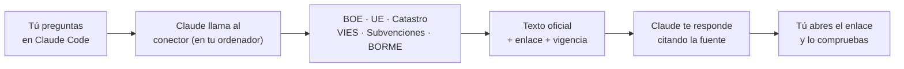

# Fuentes oficiales para Claude Code

### Que Claude no invente leyes: que las consulte en el BOE y te dé el enlace

Un conector gratuito y abierto que hace que Claude Code lea **en directo** las fuentes oficiales españolas y de la UE, **cite el enlace de cada dato** y compruebe las citas de un escrito antes de que lo firmes.

**Hecho por [Jurium](https://jurium.ai) · Comunidad [IA para Despachos](https://www.skool.com/ia-para-despachos-3662)**

   

---

## El problema

Claude responde de memoria. Y de memoria puede **inventar un artículo, citar una ley derogada o atribuir a un precepto algo que no dice**. En un despacho, eso es un escrito con una cita falsa.

## La solución

Este conector le da a Claude acceso directo a las fuentes oficiales. Cuando preguntas por una norma, Claude **va a la fuente, lee y te dice de dónde sale**.

- **Corre en tu ordenador.** No hay servidor de Jurium por medio: Jurium no recibe tus consultas.
- **Solo lectura**, y solo webs oficiales de una lista cerrada.
- **Cita siempre la fuente.** Si algo no aparece, dice «no consta» en lugar de inventarlo.
- **Sin dependencias.** Solo Python estándar: no instala paquetes de terceros.

---

## Qué puedes hacer con él

| Quieres... | Pregúntale a Claude |
|---|---|
| Leer un artículo **vigente** | «¿Qué dice hoy el artículo 20.Uno.23 de la Ley del IVA? Dime desde cuándo rige esa redacción.» |
| Saber qué lo ha modificado | «¿Qué normas han modificado el artículo 20 de la Ley del IVA?» |
| **Revisar las citas de un escrito** | «Revisa estas citas antes de presentar el escrito: [fragmento con huecos como `[cliente]`]» |
| Normativa europea | «¿Qué dice hoy el artículo 6 del RGPD sobre la licitud del tratamiento?» |
| Novedades del BOE | «¿Qué se publicó ayer en el BOE sobre subvenciones a la digitalización?» |
| Subvenciones abiertas | «¿Qué convocatorias de ayudas para digitalización de pymes hay abiertas?» |
| Datos catastrales | «Dame los datos catastrales de la referencia [referencia catastral].» |
| Validar un NIF-IVA europeo | «¿Está dado de alta en VIES el NIF-IVA [ESB...] de este proveedor?» |
| Actos del BORME de hoy | «¿Qué actos se han publicado hoy en el BORME para [provincia]?» |

> Cada consulta tarda entre 5 y 60 segundos porque lee la web oficial en directo.
> Después de instalarlo, pídele a Claude «¿qué puedo preguntar al conector?» y te da diez ejemplos más.

### La herramienta estrella: `verificar_escrito`

Le pasas un fragmento de un escrito y comprueba que **cada artículo de ley citado existe y está vigente**. Lo que no puede comprobar lo marca como «no comprobado» y te dice cómo hacerlo.

Importante: que una cita exista no significa que **diga lo que el escrito afirma**. Eso se sigue leyendo.

---

## Instalación en 4 pasos

> Necesitas **Claude Code** (la app de escritorio, pestaña Code, o el terminal) y **Python 3.11 o posterior**.
> Dura unos 5 minutos. No escribes nada técnico: lo hace Claude.

| Paso | Qué haces |
|:-:|---|
| **1** | Abre **Claude Code**. Vale cualquier carpeta de trabajo. |
| **2** | Abre [`INSTALAR.md`](INSTALAR.md) y copia el texto que va entre **«Pega desde aquí»** y **«hasta aquí»**. |
| **3** | Pégalo en Claude Code y pulsa Intro. Claude comprueba Python, copia el plugin y te avisa de la privacidad. |
| **4** | Cuando te lo pida, **cierra Claude Code, ábrelo y pega el mismo texto otra vez**. Seguirá por donde se quedó y terminará con una primera consulta de prueba. |

Funciona en **Windows y Mac**. Si algo falla: [`FAQ.md`](FAQ.md), o pídele a Claude «ejecuta el diagnóstico del conector».

---

## Dos versiones

Esta es la **versión abierta** (light). Existe otra más completa, la **versión Pro**, que va reservada a los clientes del servicio [Líder IA](https://jurium.ai) de Jurium.

| | **Light** (este repositorio) | **Pro** (clientes de Líder IA) |
|---|:-:|:-:|
| Normativa del BOE: artículos vigentes, buscador, índice, modificaciones | Sí | Sí |
| Normativa de la UE | Sí | Sí |
| Catastro, VIES, subvenciones, BORME del día | Sí | Sí |
| `verificar_escrito` (existe y está vigente) | Solo leyes del BOE y de la UE | Completo, también doctrina y jurisprudencia |
| Doctrina de Hacienda, Tribunal Constitucional, TJUE | No | Sí |
| Jurisprudencia | No | Sí |
| Convenios colectivos | No | Sí |
| Fichas de sociedades | No | Sí |
| Diagnóstico y estado de las fuentes | Sí | Sí |
| Soporte | La comunidad | Acompañamiento de Líder IA |

**La línea es sencilla: la ley es abierta y gratuita; la doctrina, la jurisprudencia y lo que rodea al despacho van con Líder IA.**

---

## Aviso importante

- **Informativo y sin garantía.** El texto consolidado del BOE, el de la UE y los datos de las demás fuentes pueden estar desactualizados o cambiar de formato. **Lo revisa siempre un profesional** antes de usarlo en un escrito o en un consejo.
- **Sin soporte.** Se actualiza cuando se puede. Las dudas, en la [comunidad](https://www.skool.com/ia-para-despachos-3662).
- No sustituye el criterio profesional ni una base de datos jurídica.

## Privacidad

El conector consulta solo webs oficiales de una lista cerrada, por HTTPS. **Claude (Anthropic) ve lo que escribes y lo que devuelven las fuentes**, como en cualquier conversación de Claude Code.

- **No pongas datos personales de clientes** en las consultas. El conector rechaza un DNI o un NIE, pero **no puede detectar un nombre de persona**.
- `verificar_escrito` no envía el texto a las fuentes, pero **pasa por Claude**: pega solo el fragmento con las citas, con huecos (`[cliente]`, `[importe]`).

## Fuentes, atribuciones y uso responsable

Herramienta no oficial: no está avalada por el BOE, la Comisión Europea, la Dirección General del Catastro ni la IGAE, y no sugiere su respaldo ni su participación. Las condiciones de cada fuente pueden cambiar sin aviso: se enlazan, no se copian (revisadas el 6 de noviembre de 2026). La licencia del código no cubre los datos de las fuentes, ni sus logos, marcas o diseño.

| Fuente | Atribución | Condiciones que importan |
|---|---|---|
| BOE y BORME | Basado en datos de la Agencia Estatal Boletín Oficial del Estado (https://www.boe.es) | El texto consolidado es informativo y sin valor oficial; solo es auténtico el del BOE electrónico |
| Subvenciones (BDNS) | Origen de los datos: Intervención General de la Administración del Estado | Se indica la fecha de actualización cuando consta; sin datos de personas físicas |
| Normas de la UE (EUR-Lex, CELLAR) | © Unión Europea, https://eur-lex.europa.eu (CC BY 4.0; el texto puede estar adaptado o resumido) | Solo son auténticos los textos del Diario Oficial de la Unión Europea |
| Catastro | Dirección General del Catastro | Datos no protegidos, citando la fuente; la sede limita las peticiones por IP y restringe los procesos automáticos |
| VIES | Comisión Europea | Para validar el NIF-IVA de operaciones propias (facturación); no se guarda ni se redistribuye nada |

- **Una consulta cada vez**, sin barridos ni descargas masivas y sin repartir peticiones entre equipos. El Catastro bloquea unos 10 días por exceso; VIES avisa cuando está saturado: espera.
- Este conector **no guarda resultados** de VIES ni del Catastro y no incluye datos de ninguna fuente: cada persona consulta en directo y responde de su uso.
- **Sin datos de personas físicas:** el RGPD y la LOPDGDD aplican a quien consulta.

## Transparencia sobre Jurium

Jurium es el autor de este conector. El plugin incluye una skill, `jurium-recursos`, que **solo se activa si preguntas cómo implantar la IA en tu despacho**: entonces Claude menciona una vez, diciendo que Jurium es el autor, el servicio Líder IA y la comunidad. Puedes borrar la carpeta `plugins/fuentes-oficiales/skills/jurium-recursos` sin que el resto cambie. Nada promocional sale en la respuesta de ninguna herramienta jurídica.

## Desinstalar y actualizar

- **Actualizar:** vuelve a pegar el texto de `INSTALAR.md` con la versión nueva; Claude sustituye la anterior entera y tus datos se conservan.
- **Desinstalar:** borra `.claude/skills/fuentes-oficiales` de tu usuario.

## Licencia

Código bajo licencia MIT ([LICENSE](LICENSE)). El nombre y el logo de Jurium no se licencian.

Versión 0.3.1 · [Novedades](NOVEDADES.md) · [Preguntas frecuentes](FAQ.md)
